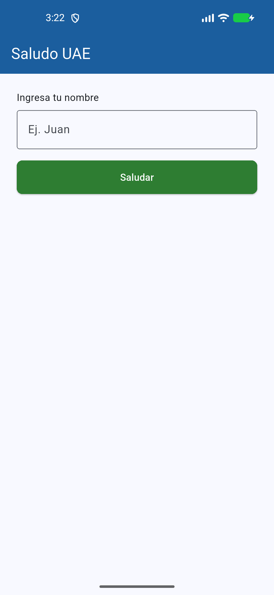
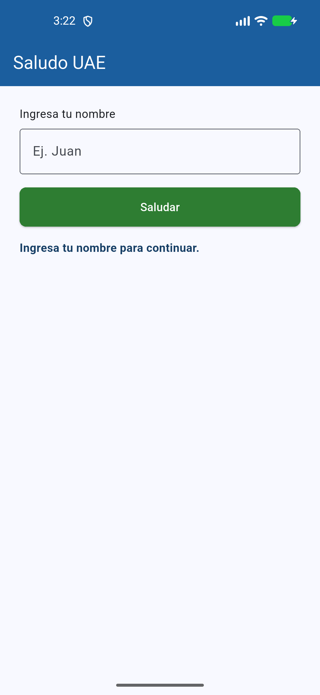
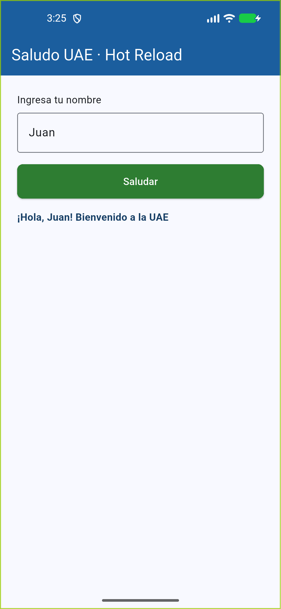

# SaludoUAE

Taller 5 · Lenguaje de Programación 5 · Universidad Agraria del Ecuador

Aplicación Flutter que muestra «¡Hola, Juan! Bienvenido a la UAE» al pulsar **Saludar** después de escribir Juan. Si el campo está vacío o contiene únicamente espacios, la pantalla solicita un nombre. La interfaz y la lógica están en [lib/main.dart](lib/main.dart), con comentarios en cada línea de código.

## Integrantes del grupo

**Paralelo 6SB · Grupo 6**

1. Luna Peñafiel Romina
2. Pérez Abad Evelyn
3. Saa Chichande Solange
4. Sanaguaray Gusqui Jorge
5. Solís Calderón Dayanna

## Ejecutar en Android

Abre la carpeta del proyecto en Android Studio con los complementos de Flutter y Dart. Inicia un dispositivo virtual desde **Device Manager** y ejecuta estos comandos desde la raíz del proyecto.

```sh
flutter doctor -v
flutter pub get
flutter devices
flutter run -d ID_DEL_EMULADOR
```

Sustituye `ID_DEL_EMULADOR` por el identificador que muestra `flutter devices`. El proyecto se generó con Flutter 3.47.7 y Dart 3.13.5.

La aplicación se compiló y ejecutó en un Pixel 5 con Android 17 (API 37). `flutter doctor -v` aprobó Flutter y la cadena de herramientas de Android. La única advertencia fue por los componentes de Visual Studio necesarios para compilar aplicaciones de escritorio para Windows.

## Probar el formulario

1. Pulsa **Saludar** con el campo vacío. Debe aparecer «Ingresa tu nombre para continuar.».
2. Escribe `Juan` y pulsa **Saludar**. Debe aparecer «¡Hola, Juan! Bienvenido a la UAE».
3. Revisa la consola de `flutter run`. En modo debug, `print()` registra el arranque, la solicitud de saludo, la validación del campo y la actualización del resultado.

```sh
flutter analyze
flutter test
```

El análisis terminó sin incidencias y la prueba de widgets pasó. La prueba cubre el campo vacío, el saludo con espacios alrededor del nombre y el envío por teclado de un campo con solo espacios.

| Formulario inicial | Campo vacío | Saludo |
| --- | --- | --- |
|  |  |  |

## Comprobar Hot Reload

1. Ejecuta la app en modo debug y saluda a Juan.
2. Cambia temporalmente el título `Saludo UAE` del `AppBar` en [lib/main.dart](lib/main.dart), guarda y pulsa `r` en la consola de `flutter run`.
3. Comprueba que el título cambia y que el nombre escrito y el saludo siguen en pantalla. Restaura el título y pulsa `r` de nuevo.

En el Pixel 5, Flutter informó **713 ms** al cambiar el título a «Saludo UAE · Hot Reload» y **648 ms** al restaurar el título original. El campo conservó `Juan` y el resultado siguió mostrando «¡Hola, Juan! Bienvenido a la UAE».



## Android nativo y Flutter

En Android nativo con el sistema de vistas, el XML define la interfaz, `findViewById` permite acceder al `EditText` y `setText` actualiza el `TextView` con el saludo. Flutter describe la interfaz en Dart con un árbol de widgets. Un `TextEditingController` permite leer el nombre con `_ctrl.text`. Después de validar el campo, `setState` guarda el mensaje y programa la reconstrucción de la pantalla para mostrarlo.
